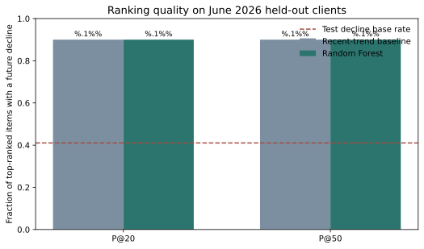
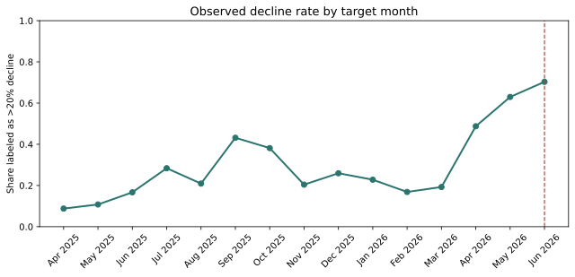
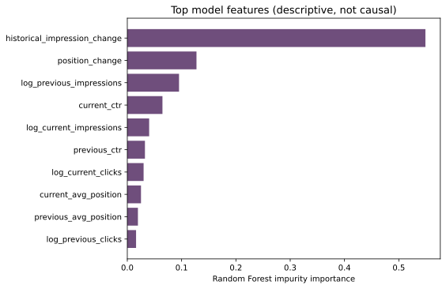
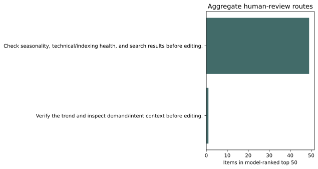

# Can prior search signals flag next-month content decline across new clients?

- **Author:** Mahdia Faheem
- **Lane:** ML-11 capstone
- **Repo:** [MahdiaFaheem/Assignment-1](https://github.com/MahdiaFaheem/Assignment-1)
- **Date:** 2026-11-14

## 1. Problem framing

This analysis asks whether two completed months of Google Search Console (GSC) signals can rank content items whose average daily impressions will fall by more than 20% in the immediately following month. The unit is one pseudonymized content item for one client and one target month. The output is a review-priority score; an editor investigates high-ranked items for seasonality, technical/indexing issues, search-intent changes, or content concerns. A false positive spends review time, while an unjustified edit can damage a useful page, so the score never triggers an automatic change.

## 2. Data safety

The analysis uses the gated **FlyRank/internship-warehouse** release, build `flyrank_pseudonymized_warehouse_release_v20260703`, specifically `fact_content_daily_performance`. The published fact table has 78,835,655 daily rows from 2025-01-27 through 2026-06-30. Monthly aggregation and eligibility filters produced 469,410 client-content-month examples across 47 clients.

Data credit: [FlyRank](https://flyrank.ai) and the [FlyRank internship warehouse release](https://huggingface.co/datasets/FlyRank/internship-warehouse).

The query checks each client's `gsc_data_start`, filters on `gsc_data_available`, and requires at least 20 available GSC days in each of the two feature months and the target month. The two feature months must contain at least 200 impressions combined. The fixed-window `fact_content_query_90d` table was excluded because its window overlaps the outcome; GA4 was excluded because its availability varies and the question is specifically about GSC. Hashed client/content IDs are used only for grouping, splitting, and the local review queue; no identifier is a feature or shown in the public report. No names, URLs, titles, keywords, or raw queries are included.

## 3. Baseline

The transparent baseline ranks items by the inverse of the recent relative impression-rate change: a larger recent drop ranks higher. It is a fair comparison because it uses only the same two prior feature months, requires no model fitting, and targets the same next-month decline label.

| Ranker | Test base rate | ROC AUC | Average precision | P@20 | P@50 | P@100 |
|---|---:|---:|---:|---:|---:|---:|
| Recent-trend baseline | 41.0% | 0.721 | 0.646 | 90% | 90% | 86% |
| Random Forest | 41.0% | 0.720 | 0.646 | 90% | 90% | 87% |

Both rankers are measured on the same held-out clients and target month. The baseline's P@50 is 2.19 times the test base rate, but the model does not meaningfully improve on that simple rule.

## 4. Model / analysis

For each entity, the target is 1 when next-month average daily impressions are below 80% of the mean of the two prior monthly average-daily rates. Features are log impressions and clicks rates for each prior month, current and prior average position, position change, relative historical impression change, and current/prior CTR.

The fixed model is a median-imputation pipeline with a Random Forest classifier (200 trees, maximum depth 10, minimum leaf size 50, balanced subsample class weights, random state 42). IDs, target-month data, and label-derived trend fields are excluded. The model's largest impurity importance is historical impression change (0.549), followed by position change (0.127); these are descriptive importances, not causal effects.

## 5. Evaluation

The final test is June 2026. A seeded 20% client holdout was selected from clients with eligible June examples before model fitting. The model trained on 350,172 earlier examples from 30 other clients and was evaluated on 4,245 June examples from nine clients. Training target months range from May 2025 through May 2026. The split seed and model seed are both 42.

The held-out test decline base rate is 41.0%. The full eligible June cohort's rate is 70.3%, showing that prevalence differs substantially by client composition; the held-out rate is the appropriate base rate for the test metrics and should not be treated as universal. Both methods have P@20 of 90%, P@50 of 90%, and average precision of 0.646. The baseline ROC AUC is 0.721 versus 0.720 for the model; the model's only top-k advantage is P@100 of 87% versus 86%. This is not evidence that the more complex model is a better ranker.

*Takeaway: both rankers are well above the 41.0% test base rate at the top 20 and 50, but the Random Forest does not improve the baseline there.*

## 6. Interpretation

The model largely recovers the recent-trend signal: historical impression change contributes 0.549 of impurity importance. The baseline is therefore a strong and simpler comparator, not a straw man. The decline-label rate changes considerably over time; in the full eligible cohort it reaches 70.3% in June 2026, while the held-out-client subset is 41.0%. This reinforces that one month's client-held-out result is not a guarantee of later-period performance.

*Takeaway: the observed label rate varies across months, so month and client composition matter when interpreting a ranking metric.*

*Takeaway: recent impression change dominates this model's descriptive feature importance; importance does not establish cause.*

## 7. Recommendation

Use the recent-trend rule as the simpler shadow/triage comparator; this test does not justify replacing it with the Random Forest. In the model-ranked retrospective top 50, 49 items route to checking seasonality, technical/indexing health, and search results, while one routes to verifying the recent impression trend. These are review prompts, not prescriptions to refresh or rewrite content.

*Takeaway: the queue is designed to guide human diagnosis, not automate editorial decisions.*

The evaluation is observational, covers one release and one final target month, and filters out sparse or low-impression items. It does not estimate the causal effect of a content refresh, calibrated success probabilities, revenue, editorial costs, or incremental ROI. Any future operational use needs repeated future-month validation and human review.

## 8. Reproducibility

1. Install the project dependencies with `python -m pip install -r requirements.txt`.
2. Accept the dataset gate and authenticate locally with a Hugging Face Read token using `hf auth login`; never put the token in a notebook or repository file.
3. Open `work/notebooks/capstone.ipynb` and run all cells from top to bottom. The notebook reads the full fact table once and caches the aggregate panel in `work/outputs/capstone_feature_panel_v1.parquet`.
4. The panel cache and row-level `work/outputs/capstone_ranked_queue.csv` are local and gitignored. The four SVG figures and `work/outputs/capstone_metrics_receipt.json` contain aggregate results and can be committed.

The recorded environment was Python 3.12.3, DuckDB 1.5.5, pandas 3.0.5, and scikit-learn 1.9.0. The SQL, features, split, fixed model parameters, and aggregate receipt are in the notebook and [`work/outputs/capstone_metrics_receipt.json`](outputs/capstone_metrics_receipt.json). The notebook is [`work/notebooks/capstone.ipynb`](notebooks/capstone.ipynb). The exact public deployment URL still needs to be written to `submission/paper_url.txt` after deployment.
